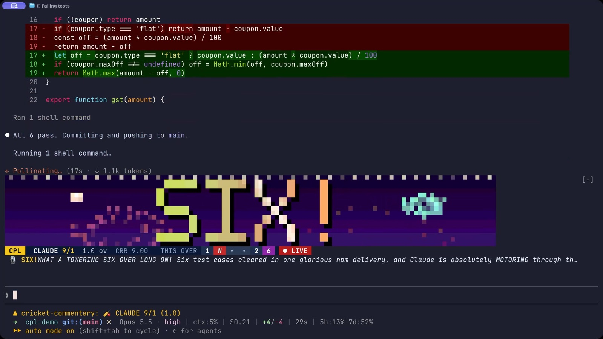
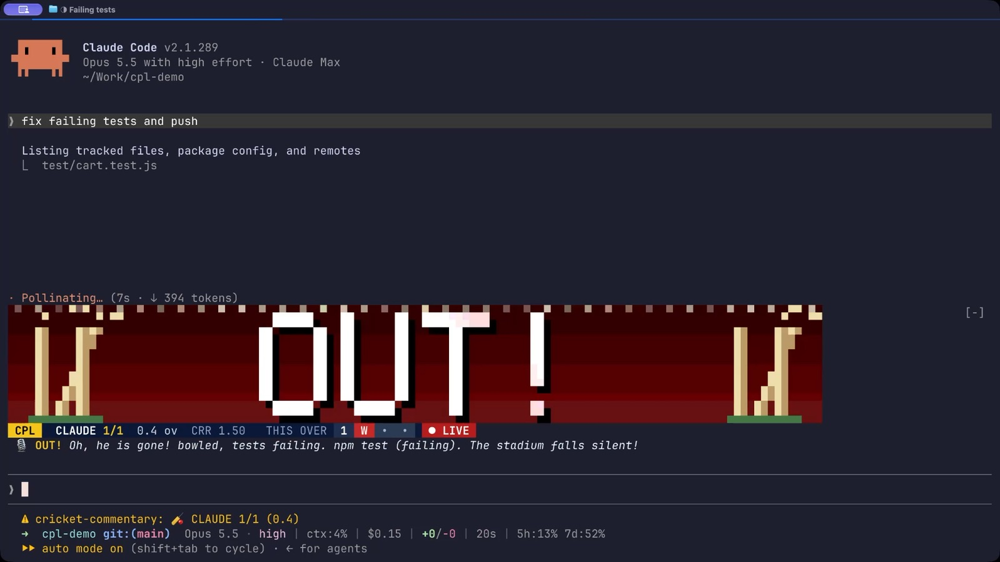

# 🏏 cricket-commentary

A Claude Code mod that turns every session into a live IPL match.

Every tool call is a ball. Failing tests get you bowled, `git push` is a six, and an Indian commentator calls every big moment out loud while the crowd roars.



## Install

In Claude Code:

```
/plugin marketplace add dhruvkumar1805/cricket-commentary
/plugin install cricket-commentary@dhruv-mods
```

Then give Claude any task. The toss happens on your first prompt. Turn your sound on 🔊

## How it scores

| What Claude does | What you get |
|---|---|
| tests pass, `git push` | **SIX** 🎆 |
| build, lint, commit | **FOUR** |
| edits | singles, twos and threes |
| reading and searching | dot ball |
| tests fail | **OUT**, bowled |
| build breaks | **OUT**, caught behind |
| command not found | **OUT**, stumped |
| `rm -rf`, force push, `sudo` | **NO BALL**, free hit |
| you deny a permission | **WIDE** |

Fifties, centuries, hat-tricks and maiden overs get their own moments. When the turn ends, the commentator names the player of the match.



## What's in the box

- **Scoreboard** above the prompt: score, overs, run rate, this over ball by ball, top batters, last wicket
- **Pixel big screen** in the terminal for sixes, fours, wickets and milestones, with fireworks, flying bails and confetti
- **Live commentary** written fresh for each moment by Claude Haiku about the actual command, with a bank of hand-written lines as backup
- **The voice**: macOS reads the commentary with its Indian English voice (Aman), or Hindi (Lekha) in Hinglish mode
- **Crowd sounds**: bat crack, roar, groan, stumps and applause, all synthesized from scratch

## Commands

| | |
|---|---|
| `/cpl` | full scorecard for the innings |
| `/cpl career` | career stats across sessions |
| `/cpl demo` | a scripted innings, to see and hear everything |
| `/cpl stop` / `start` | pause and resume the match |
| `/cpl mute` / `unmute` | the commentator |
| `/cpl crowd` | toggle the crowd |
| `/cpl hinglish` / `english` | commentary language |
| `/cpl hide` / `show` | the scoreboard |

## Notes

- Voice and crowd sounds need macOS. The scoreboard and big screen work in any terminal with true color.
- Commentary lines use a small amount of your Claude usage (one Haiku call per big moment).
- If the Aman voice isn't installed, the commentator falls back to your system voice. Add it in System Settings → Accessibility → Spoken Content → System Voice → Manage Voices.
- Mods run with the same access as Claude Code. Read the code before installing any mod, this one included. It's all in `hooks/`.

MIT · made by [@dhruvkumar1805](https://x.com/dhruvkumar1805)
